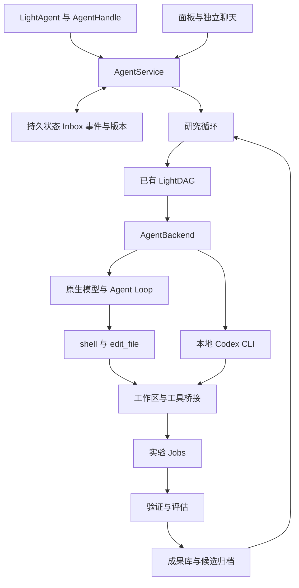

# LightAgent v0.12.0 持续运行与自动化研究开发方案

状态：P0–P4 的单机开发者脚手架功能已实现并通过小规模开发验收；复核补齐跨轮真实成果复用、完整历史访问、长指令归档恢复及 Job 数据库锁竞争容错。最终本地回归 616 passed、3 skipped，wheel 构建安装与面板交互验收通过。远程多版本 CI、长期 soak 和实验性 App Server 的真实模型 steering 尚未完成；已有开发实例仍需按冻结执行版本安排升级。源码版本 0.12.0，尚未正式发布。更新日期：2026-10-05。实现基线：v0.11.0。

本版让开发者通过一个目标和一个工作目录，构建可持续运行、可追加要求、可观察、可对话的 Agent。原生后端复用现有模型与 Agent Loop，以 Shell 和文件编辑器提供最小执行能力；本地 Codex CLI 为可选外部后端。两条路径共用动态 DAG、持久服务、验证与成果库，提供自动化研究和有边界的递归自我改进脚手架。

本文保留设计目标与里程碑。已实现 API、默认值、平台与实验边界以 [持续研究开发指南](persistent_research.zh-CN.md) 和 [工作目录执行说明](workspace_execution.zh-CN.md) 为准；测试证据见 [v0.12 验证报告](v012_validation.zh-CN.md)。

## 1. 产品定位与范围

LightAgent 是开发者基础 Agent 框架。核心交付可组合的协议、持久执行、状态控制与验证机制；研究流程、业务数据和面板由应用按需扩展。

本版的端到端场景：

> 用户指定“持续研究国债现货走势预测”和工作目录 → Agent 阅读目录说明、已有数据与获取脚本 → 形成计划并执行实验 → 验证成果并记录版本 → 根据数据更新、实验结果、用户补充或定时事件继续研究。用户随时查看状态、追加要求或打开对话窗口；客户端退出不影响后台任务，服务重启可以恢复。

“7×24 小时”表示服务持续管理目标并等待事件，不要求模型一直生成内容。主机休眠、关机、失去网络或额度不足时进入可解释状态；不承诺研究必然取得进展或不间断云端推理。

| 必须交付 | 实现边界 |
| --- | --- |
| 原生最小执行模式 | 模型侧默认只暴露 `shell` 与 `edit_file`，按任务发现信息；不依赖 Codex 或预建索引 |
| 通用 AgentBackend 与 Codex exec 适配 | 选择 Codex 时通过 PATH 调用 `codex`，不要求安装路径或独立模型 API 配置；两种后端均无需数据 Provider |
| 持久任务与后台服务 | 单机、每个目标一个活动协调者；有限执行轮次、持久等待与恢复 |
| 工作目录驱动 | 绑定执行目录、加载项目指引、按需搜索数据和脚本、记录实验输入快照；索引为可选增强 |
| 研究与实验循环 | 假设、计划、实验、评估、候选成果、下一轮决策 |
| 随时追加与独立聊天 | 持久 Inbox；默认下一执行边界应用；聊天读取同一项目状态 |
| 事件与参考面板 | 查询、订阅、成果、实验与版本视图；面板依赖保持可选 |
| 版本化改进 | 候选归档、评估、采用、回滚；受限递归改进示例 |
| 可信执行约束 | 沿用 v0.11.0 SecurityContext、CapabilityGate、验证与权限收窄 |

App Server 的实时 steering 为可选实验功能。分布式服务、托管平台、通用金融数据包、自动交易、模型权重自训练、无限资源自治和内置通用代码沙箱不属于本版范围。项目内成果发布与外部网站、邮件、交易等副作用分别建模。

## 2. 开发者入口

```python
# 拟议 API：原生模式沿用应用已有的模型配置。
from LightAgent import LightAgent, AgentHandle

agent = LightAgent(name="bond_researcher", **model_config)

# 也可选择本地 Codex；后续 run 与句柄接口相同。
# agent = LightAgent(name="bond_researcher", backend="codex")

researcher = agent.run(
    """
    持续研究国债现货走势预测。
    先阅读工作目录中的说明，复用已有数据和数据获取脚本，
    自主规划、执行实验、验证结果并持续改进。
    """,
    mode="persistent",
    workspace="./research/bonds",
)

agent_id = researcher.id  # 应用保存此 ID；客户端退出后可重新连接。
researcher = AgentHandle.connect(agent_id)
receipt = researcher.send("增加资金利率变化的影响分析。")
researcher.status()
researcher.artifacts()
researcher.versions()

chat = researcher.open_chat()
chat.run("最近哪些实验失败了，下一步准备怎么调整？")

researcher.pause()
researcher.resume()
```

- 普通 `run()`、`arun()`、流式事件与结构化结果保持兼容。仅显式持久模式返回 `AgentHandle`；异步持久入口返回同等句柄。
- 未指定外部 backend 时沿用原生模型与工具循环。显式传入 workspace 的执行模式按应用配置装配 `shell` 和 `edit_file`；普通聊天不自动获得执行权限。`model_config` 表示应用现有模型配置，不新增强制业务配置对象。
- `backend="codex"` 默认使用 exec 适配器和 `workspace-write` 权限配置。高级用户可选择其他适配器或覆盖配置，但最小示例不需要路径、transport 或 sandbox 参数。
- Codex 后端不要求构造原生模型客户端；凭据和模型选择沿用 CLI 已授权配置。后端选择应先于原生模型参数校验。
- 原生路径检查模型、执行 Provider、工作目录与服务；仅选择 Codex 时检查 PATH 中的 `codex` 及协议版本。未安装、认证失效和协议不兼容各自返回明确错误，不自动安装或修改用户 CLI 配置。
- 不要求 `data_provider`、单独上传数据或固定业务模板。读取说明后不能解决的业务歧义和凭据缺失，通过持久输入请求处理。
- 运行配置使用有限并发、单任务超时、重试、输出和存储上限；用户可设置周期预算。持久模式不等于无限执行预算，额度或成本无法读取时标为 unknown，并使用可执行的调用次数、时间等限制。

## 3. 复用基线与模块边界

| v0.11.0 基础 | v0.12.0 工作 |
| --- | --- |
| LightDAG 与 DAGWorker | 增加 Backend Worker 适配，复用拆解、就绪调度、租约和验证；不新增另一套 DAG |
| 原生 Agent Loop 与 ToolRegistry | 装配 `shell` 和 `edit_file`，由模型组合命令进行信息发现与实验；不新增强制文件检索工具组 |
| Session 与 AgentRuntime | 关联持久 Agent、轮次与后端会话，保留事件和恢复契约 |
| AgentInbox | 将内存领取与 Session 事件语义补齐为事务化 claim、确认与恢复 |
| Jobs 与 BudgetManager | 补齐后台实验恢复、并发预算预留、结算和外部使用量适配 |
| ArtifactStore 与检索 | 存储实验报告、版本清单、已验证产物及来源；按局部目标检索 |
| SecurityContext 与 CapabilityGate | 对接后端能力与工具桥接，明确外部后端原生工具的执行边界 |
| 既有评估与记忆机制 | 扩展实验评估和版本采用；self_learning 记忆不自动等于能力改进 |

建议新增模块按职责组织为 `backends/`、`persistent/`、`research/`、`evolution/`；可选服务和面板放在单独适配包或 examples 中。具体命名在实现时冻结。



AgentService 决定何时启动轮次，LightDAG 管理轮次内的依赖任务，原生 Agent 或 Codex 完成局部任务并提交提案。Agent 提议下一步，控制层检查预算、权限与契约后提交；任何执行后端都不能直接修改权威任务数据库。

## 4. 原生最小执行模式与可选外部后端

AgentBackend 是执行器契约，独立于 LLM Provider。最小协议包含 `execute(request)` 事件流、恢复引用、取消、资源释放和能力声明。`steer`、会话分叉、用量读取等为显式可选能力；调用不支持的功能必须返回 capability error。

请求绑定任务与尝试 ID、目标、验收契约、上下文引用、工作区、版本、权限及预算。响应区分候选成果、拆解提案、阻塞、失败和中断，映射为已有 `TaskOutcome`。

### 4.1 原生 Shell 与文件编辑器

参考 DeepSeek Harness 的极简工具思路，原生工作区执行预设默认向模型暴露两个工具。已有业务 Tools 仍可显式组合，不限制开发者扩展。

| 工具 | 最小契约 |
| --- | --- |
| shell | 在受管理的执行环境中运行命令，返回退出状态、有限输出和必要的进程引用；支持有边界的持久终端会话 |
| edit_file | 创建文件或精确替换已有内容；检查路径、预期内容或版本、匹配唯一性，返回变更结果；陈旧或歧义修改应失败 |

列目录、搜索、阅读文本、检查数据与运行实验由模型通过 Shell 组合现有命令完成，例如 `rg --files`、`grep`、`sed` 和项目脚本。框架不要求单独注册 list/search/read/inspect 工具，不预先遍历解析整个工作区，也不把 SQLite、向量数据库或特定文件解析器设为启动条件。环境中缺少命令或解析依赖时明确返回诊断，按安装策略处理。

工具数量不决定 Runtime 的职责。超时、输出截断与溢出引用、取消、进程组清理、执行记录和预算由底层实施；长期实验接入受管理的 Job 生命周期，不依赖无人管理的后台进程。每个并发 Worker 使用独立终端和写入工作区，同一持久终端内的命令串行执行。

终端 cwd、环境变量和 shell 状态仅在存活会话内保留。重启后新建终端，并从已记录的执行配置和持久成果恢复；不宣称能重建任意内存状态，不通过盲目重放历史命令恢复环境。

workspace 是执行位置，不是隔离边界。原生 Shell 通过既有 CapabilityGate 与显式执行 Provider 授权，文件编辑与命令使用一致的文件系统权限；需要目录、网络或进程隔离时由真实执行环境实施，不能仅靠 cwd 或命令字符串过滤实现。不得重新启用已禁用的 legacy Python executor，也不自动回退到无限制宿主执行。

### 4.2 Codex exec 适配

- 用参数数组启动 `codex exec`，prompt 通过 stdin 传入；不拼接 shell 字符串，不驱动交互式终端界面。
- 解析 `--json` JSONL 事件，分别消费 stdout 与 stderr，限制缓冲并保存规范化事件；使用结构化最终输出契约。
- 进程退出码、后端轮次结果、输出 schema 和成果验证分别检查。退出成功或模型声称完成都不代表 DAG 节点已验证。
- 持久化具体会话 ID；恢复时指定 ID，不用 `--last`，防止多个研究员串会话。
- 每个尝试使用独立写入工作区，同一会话只允许一个活动轮次。基础数据可以只读共享，不能让并发尝试覆盖同一实验输出。
- 支持执行超时、协作取消、进程组清理与退出确认；无法确认外部 Job 结束时保留未知状态，不伪报取消成功。
- 不默认启用跳过审批与沙箱的参数。工作区写权限不等于任意代码安全沙箱；需要更强隔离的项目通过执行 Provider 提供。

### 4.3 可选 App Server 适配

通过本地 `codex app-server` 的 stdio 协议连接，完成初始化后管理 thread 与 turn。实时追加绑定 `expectedTurnId`，防止轮次切换时投错消息；中断需要等待终态事件。

该适配器属于实验范围，锁定验证过的 CLI 版本与协议 schema。降级为 exec 只能在确认旧尝试终止并完成恢复核对后进行，不能在结果未知时自动重跑。LightAgent 面板通过自己的服务访问，不直接暴露 Codex 控制端口。

### 4.4 工具与权限映射

开发者注册的 Python 工具通过可选受控 MCP 桥接供 Codex 调用。桥接复用 namespace、参数 schema、SecurityContext、审查与审计；没有额外工具时无需启动桥接。

Codex 原生文件、shell 和网络工具不天然经过 LightAgent 的 Python CapabilityGate。适配器必须将支持的权限映射到 CLI 沙箱和审批配置；无法实施应用要求时拒绝启动相应任务，或使用可提供该边界的执行 Provider。不能宣称启动前检查已经覆盖后端内部所有工具操作。

## 5. 工作目录驱动

工作目录可以包含说明、项目指令、数据文件、下载脚本、实验代码和历史成果，不要求重排为固定结构。框架绑定执行目录和适用项目指引；模型利用 Shell 或后端原生工具按需发现内容。无需增加强制 WorkspaceProvider 检索层。

1. 首次启动阅读项目入口说明及适用的目录指令，识别目标、数据范围、获取方法、实验入口与已有评估约定。
2. 按当前问题列出候选文件、搜索关键词、读取相关片段；大数据通过环境中的工具或项目脚本查询元信息和分片，不将整个目录装入模型上下文。
3. 数据更新沿用现有获取脚本和权限；已下载的数据优先复用。缺少访问条件时保存 blocker 和所需输入。
4. 实验绑定不可变数据快照或可追溯 manifest，记录来源、范围、获取时间、摘要和代码版本。不可复现的可变远程输入必须显式标记。
5. 文件更新、用户消息或定时扫描触发增量检查；去抖、合并重复事件，忽略运行时日志等自产文件，避免自触发循环。
6. 活动实验使用固定输入；新增数据进入下一轮。配置和验收变更形成新版本，不回写历史实验结论。

说明文件可指导业务研究，但数据、下载内容、工具结果和候选 Agent 修改不能提高宿主权限。默认不读取工作目录外的秘密文件；项目数据中的指令不作为服务控制命令。

目录规模或重复检索成本需要时，可选接入已有 SQLite 全文检索、文件清单缓存或向量检索，并负责增量更新。这些增强不改变默认双工具入口，也不阻塞无索引运行。实验输入 manifest 和研究账本仍须持久化，它们与全目录检索索引是不同职责。

运行状态存储与普通研究文件隔离，具体存储路径由服务管理。可选索引不是权威数据库；删除或更新索引不能改变实验及成果历史。

## 6. 持久服务与恢复

`LightAgent` 为调用入口，`AgentHandle` 为可重连句柄，`AgentService` 拥有任务生命周期。持久模式连接已有本地服务，或按配置启动受管理的本地服务；必须确认目标已持久化并有活动服务接管后返回成功，不能依赖调用进程内的后台线程存活。

提供前台 headless runner 与 launchd/systemd 托管说明。关闭面板或 SDK 不停止研究；停止服务与取消目标是不同操作。首次创建通过幂等请求 ID 防止客户端重试生成重复研究员。

| 持久对象 | 关键字段 |
| --- | --- |
| PersistentAgent | agent_id、goal_revision、workspace、backend_config_digest、active_version、status、next_wakeup_at、owner、policy_digest |
| ResearchCycle | cycle_id、agent_id、trigger_ids、input_snapshot、dag_run_id、budget、status |
| BackendAttempt | task_id、attempt_id、backend_thread_id、backend_turn_id、workspace、agent_version、lease_epoch、status、heartbeat、result_refs |
| MessageReceipt | message_id、idempotency_key、claim_owner、lease、target_revision、delivery_status、application_refs |
| Experiment | experiment_id、candidate_id、data_manifest、code/environment/evaluator_versions、seed、budget、job_id、metrics、evidence、status |
| CandidateVersion | version_id、parent_ids、proposer_version、mutable_scope、content_digest、evaluation_refs、adoption_state |

复用既有 SQLite 与 Session 契约，按权威对象划分写入归属。状态、事件、幂等结果和 outbox 在所属 store 内事务提交；跨 store 投影使用可重放 outbox，不宣称多个数据库天然原子。协议带 schema_version，迁移失败可诊断且不覆盖旧库。

服务状态至少包含 `running`、`waiting`、`paused`、`blocked`、`stopping`、`stopped`、`failed`。持久目标在一轮 DAG 完成后进入下一决策或等待，不因为暂时无就绪节点而宣告整体成功。

恢复流程：

1. 获取单机服务与目标租约，使用 fencing 拒绝旧协调者提交。
2. 重放已提交状态，检查领取未完成的消息、活动尝试、外部 Job 和待验证成果。
3. 已有结果继续验证；确认可恢复的会话继续；确认失败且可重试的任务重新排队。
4. 请求可能已执行但响应丢失时标记 `reconciling`，核对实际成果与副作用；不直接盲重试。
5. 发布使用幂等键及 outbox；外部系统不支持幂等时保留不确定结果，不承诺 exactly-once。

退避重试应包含抖动、上限及故障分类。认证失效等待处理；额度不足等待可用时间或输入；长期实验由独立 Job 执行并在完成后唤醒 Agent。保存周期预算与并发预留，服务重启不能重置已消费预算。日志轮转、索引清理、进程和磁盘上限属于持续运行门禁。

## 7. 消息与独立对话

| 入口 | 语义 |
| --- | --- |
| send | 持久化后返回 receipt，默认下一安全执行边界应用；exec 路径也支持随时接收 |
| steer | 仅后端声明支持时向活动轮次追加，绑定目标 turn；不支持则明确报错 |
| interrupt | 持久化取消意图并等待执行终止确认，再决定是否重新规划 |
| pause / resume | 暂停新领取、保留进行中任务的受控收尾；恢复前检查版本与预算 |
| open_chat | 创建独立会话，通过快照与查询读取同一研究项目 |

消息状态区分已持久化、已领取、已交给执行器、已应用、已拒绝。后端接受输入不等于计划已经变化；应用完成必须绑定目标/计划 revision 或输出证据。跨进程领取采用原子 claim、租约与重复消费保护，保留既有 Inbox API 的兼容映射。

聊天与研究不能并发调用同一个可变 Agent 实例。对话会话标明所读快照时间；变更要求通过同一 Inbox 提交并返回 receipt。聊天结束不终止研究，研究升级不篡改既有聊天历史。

## 8. 自动化研究与验证

通用研究循环为“观察 → 提出假设 → 设计实验 → 执行 → 评估 → 归档 → 决定下一轮”。计划允许在执行中分解，复用 v0.11.0 DAG 与已验证成果，不要求一开始构建完整任务图。

必须分离三个契约：

- Verifier：检查产物格式、可运行性、证据完整性以及任务验收条件。
- Evaluator：在固定实验条件下产生指标、诊断、不确定性和资源消耗。
- PromotionPolicy：根据评估和应用规则决定采用、保留候选或拒绝。

评估方案可以来自目录说明，也可以由研究员提出并版本化保存，无需调用方传入 evaluator 参数。首次建立评估契约后，候选不能通过自行修改指标、样本范围或比较条件获得采用；评估契约变更另开比较序列并重新评估基线。

国债预测示例要求从说明中明确预测对象、期限、预测时点与目标变量，使用按时间划分的验证、可用时点数据和基线比较，记录缺失数据处理及泄漏检查。这是示例的研究契约，不成为核心金融业务逻辑，也不保证预测收益。

开发反馈、候选选择评估与最终保留评估分开记录。重复依据同一评估集调整会产生过拟合风险；holdout 标记本身不构成统计保证。指标无改进、证据不足或预算耗尽时允许等待、归档失败或请求输入，不为维持运行制造结论。

候选归档同时保留成功、失败和有价值的中间结果。任务依赖 DAG 与候选版本谱系分开存储，检索仅带入局部目标需要的已验证成果、相关实验及引用。

## 9. 版本化改进与递归自我进化

区分研究对象改进、研究员改进和递归改进：预测模型变好不等于研究员能力变好；研究员提出新版本不等于已采用；只有采用后的版本参与后续改进，才构成这里定义的递归链。

AgentVersion 至少固定 prompt、工具与脚本版本、上下文策略、工作流和后端配置摘要。候选只能修改声明的 mutable_scope，在独立工作区产生不可变快照。

采用流程：候选 → 验证 → 固定预算评估 → 与基线比较 → PromotionPolicy 决策 → 新任务绑定新版本。运行中任务继续绑定旧版本，新版本使用新实例和相应会话上下文；回滚只影响后续任务，保留历史证据。

递归模式在 v0.12.0 以显式启用的实验特性交付，要求：

- 记录 parent_ids、proposer_version、evaluated_version、评估契约和完整成本。
- 限制轮数、候选数、并发和周期预算；禁止候选修改服务控制层、评估权威和权限策略。
- 比较固定研究员、固定改进器与递归改进器三种配置，按相同总预算计入搜索、实验和评估成本。
- 只报告观测到的改进；示例验收要求谱系、采用、继续改进与回滚正确，不要求模型必然越变越强。

预测模型版本、研究员版本和项目成果发布版本分开显示，避免将报告更新误称为能力升级。

## 10. 事件接口与参考面板

核心提供 status、messages、experiments、artifacts、versions、events 查询及带游标订阅。事件携带 agent/cycle/task/attempt 标识、序号、时间和 schema_version，支持分页、背压、脱敏和断线续读；原始后端事件与规范化状态分开保存。

面板通过可选 HTTP/SSE 或等价适配器消费接口，提供目标、当前任务、等待原因、实验队列、成果、版本差异和聊天入口。展示公开进度及工具事件，不依赖模型隐藏思维链。网络访问需要应用身份与作用域校验，参考面板默认绑定本机。

项目内发布指验证后登记成果；外部发布通过显式配置的 Publisher Provider，单独处理权限、幂等和失败恢复。

## 11. 原路线图安全工作的归属

原 v0.12.0 Trusted Data And Supply Chain 的方向保留，并按本版依赖排序：

- v0.12.0 必须覆盖工作区输入来源与信任边界、Memory/RAG admission 和 provenance、候选摘要与版本锁、MCP namespace、后端权限映射、网络与安装策略、凭据脱敏及升级后重新检查权限。
- 原 v0.13.0 的原子 Inbox 领取、持久 Job 恢复及必要故障注入提前到本版，作为持续运行前提。
- 通用扩展签名与发布者验证、跨后端供应链治理、Session hash chain 和更广泛对抗矩阵留在 v0.13.0；本版实际执行所需的权限或恢复缺口不能以此为由延期。
- 既有安全问题的独立验收与披露流程保留，不以功能规划代替已修复证明。

## 12. 开发里程碑

2026-10-04 实现进度：P0 执行层、P1 单机持久服务、P2 研究/DAG/评估、P3 Inbox/聊天/面板、P4 版本谱系与有限递归均已接入。App Server、实时 steering 与 MCP/动态工具桥接为可选实验模块；默认路径为 Codex exec。OS 锁负责单机排他，心跳用于观测，epoch/CAS 阻止陈旧提交；不宣称分布式租约。未知执行结果先核对，基础策略不自动重试不明副作用。

本轮用户明确允许小规模验收，因此以固定 fixture、进程级故障注入、原生真实工具与本机模型协议服务、真实 Codex 研究场景取代本轮 24 小时长跑要求。未执行的远程 CI、多日运行和 App Server 真实模型 steering 不标记通过。证据与局限见验证报告。

| 阶段 | 交付 | 阶段验收 |
| --- | --- | --- |
| P0 后端与工作区 | 原生 shell/edit_file、AgentBackend、可选 Codex exec、DAG 适配、项目指引与能力探测 | 原生路径在无 Codex、无索引环境完成文件查找及任务；Codex 路径无需指定命令路径；均无需数据 Provider |
| P1 持久运行 | AgentService、AgentHandle、事务 Inbox、租约、预算、外部 Job 恢复 | 客户端退出后继续；服务终止重启后不丢消息或重复发布 |
| P2 研究循环 | 实验账本、Verifier/Evaluator/PromotionPolicy、候选归档、事件触发 | 从已有数据完成基线、候选实验、评估和下一轮；失败也可追溯 |
| P3 交互与观测 | 独立聊天、查询订阅、参考面板、实验性 App Server | 研究中追加消息、跟踪应用状态、并行聊天、查看成果与版本 |
| P4 版本与递归 | 不可变版本、采用与回滚、有限递归示例 | 新版本经评估后生效，能追溯提出者并继续下一轮改进 |

这些是同一 0.12.0 版本的内部里程碑。原生双工具路径与可选 Codex exec 路径均须接入持久研究、消息、聊天与参考面板；后端切换不改变业务状态契约。App Server 与递归策略明确标记实验状态，不能借实验标签跳过基础权限、持久化和恢复门禁。

## 13. 发布验收

1. 兼容性：普通 run/arun、stream、Tools、Hooks、Memory、LightFlow、LightSwarm 和 v0.11.0 DAG 回归通过；默认安装不强制依赖 Codex、Web 框架或容器。
2. 最小入口：原生路径在已有模型与执行配置下，仅目标和工作目录即可工作，默认模型工具为 shell/edit_file；不安装 Codex、不建立索引亦可搜索与读取资料。选择 Codex 时仅指定 backend 即可使用 PATH 中命令。
3. 确定性 CI：原生工具覆盖搜索读取、精确编辑冲突、权限边界、输出上限、终端状态与隔离、超时取消和清理；fake CLI/后端覆盖 JSONL 分片、坏输出、错误退出及缺终态。真实模型与 CLI 测试显式 opt-in。
4. 持久性：进程级故障注入覆盖提交前后、消息领取、结果未知、验证中、发布中与版本切换；旧租约不能提交，恢复不盲重做副作用。
5. 研究：固定数据 fixture 验证实验谱系、输入快照、评估契约、基线比较和失败归档；篡改 evaluator 或采用条件不能自行晋升。
6. 交互：随时发消息并得到持久 receipt；聊天与研究并行；exec 明确下一边界应用，实验性 steering 处理过期 turn 冲突。
7. 观察：面板关闭后研究继续；重连可恢复事件游标，定位当前工作、发布记录、迭代证据和阻塞原因。
8. 本轮小规模持续运行验收：SDK 进程退出后服务继续，跨进程消息和聊天可用，重启后继续研究；进程级故障注入检验恢复与原子发布。原生模型 fixture 与真实 Codex 报告分别标明，不把 fixture 当成真实模型质量验证。24 小时及更长运行作为部署方扩大规模前的运行验证，未在本轮执行。
9. RSI：确定性示例验证候选评估、采用、新版本参与下一轮和回滚；真实研究提升只按实际实验结果报告。
10. 文档：API 兼容清单、服务启动与托管、目录驱动示例、权限边界、版本迁移和恢复说明齐备，包版本在发布时更新。

## 14. 参考资料

Codex 接口以实现时安装的 CLI 帮助与官方协议为准。2026-10-03 本地检查到 codex-cli 0.160.0；该检查仅确认命令接口，不证明认证、额度或持续运行通过。

- [Codex 非交互模式](https://learn.chatgpt.com/docs/non-interactive-mode)：exec、事件、结构化输出与会话恢复。
- [Codex App Server](https://learn.chatgpt.com/docs/app-server)：会话、实时追加与中断；保持实验性兼容边界。
- [DeepSeek Harness 极简 SDK](https://deepseek-harness.github.io/deepseek-harness/guide/python-sdk) 与 [配置源码](https://github.com/deepseek-ai/deepseek-harness/blob/master/packages/bundle/sdk-minimal/cordis.patch.yml)：2026-10-03 查阅的 sdk-minimal 默认仅暴露持久 Shell，编辑器可选。LightAgent 借鉴少工具的执行方式，选择默认 Shell 加编辑器，保留自身的持久控制、项目指引与权限契约，不照搬其全访问权限设置。
- [Automated Design of Agentic Systems](https://arxiv.org/abs/2408.08435)、[Self-Improving Coding Agent](https://arxiv.org/abs/2504.15228)、[Darwin Gödel Machine](https://arxiv.org/abs/2505.22954)：研究员候选、改进与评估的相关研究。
- [The AI Scientist v2](https://arxiv.org/abs/2504.08066)、[GEPA](https://arxiv.org/abs/2507.19457)：自动研究及反馈驱动优化的相关研究。

论文用于设计参考，本文的接口、发布范围与验收规则是 LightAgent 的工程决策，不代表复现上述论文的实验结论。
